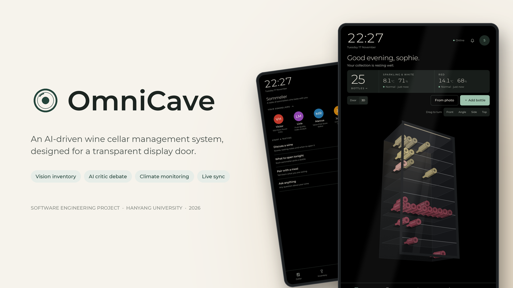

# OmniCave

**An AI-driven wine cellar with a transparent display door**

> 26-2 Hanyang University Software Engineering Project

<picture>
  <source media="(prefers-color-scheme: dark)" srcset="documents/images/hero-light.png">
  
</picture>

## Overview

Premium wine cellars today are passive appliances: they hold temperature and humidity, but the owner still tracks
every bottle by hand, in a notebook or a separate app that never matches what is physically inside. OmniCave turns
the cellar into an actively managed collection. The glass door becomes a transparent OLED display that shows exactly
what is stored and where, and the cellar keeps its own inventory up to date.

The system rests on three ideas:

- **The cellar knows its contents.** A vision pipeline reads labels and maps each bottle to a position in
  centimetres, including bottles stacked freely without fixed slots. The owner only confirms what was recognised.
- **Expert opinion on every bottle.** Several fictional wine critics, each with its own scoring philosophy, debate a
  wine live on the door. They share one base language model with a separate LoRA adapter per critic, swapped on the server.
- **A thin appliance, a smart cloud.** All AI runs in the cloud, so the cellar's own computer stays small, cool and
  cheap, and every feature is shared with the companion app.

## Architecture

<picture>
  <source media="(prefers-color-scheme: dark)" srcset="documents/images/architecture-light.png">
  
</picture>

## Key Features

- **Automatic inventory:** bottles are detected, their labels read and their positions mapped, then confirmed by the owner.
- **Transparent door display:** a to-scale door map and a 3D view of the cellar on a see-through OLED panel.
- **Climate monitoring:** temperature and humidity per zone, with history and alerts when conditions drift.
- **AI sommelier table:** fictional critics taste and debate a bottle, streamed word by word.
- **Daily briefing and collection value:** personalised wine news, bottles ready to drink, and market value over time.
- **Multi-device, multi-cellar:** the door display, the Android app and the iOS app stay in sync live over WebSocket, across several cellars, with offline caching.

## Demo Video

<!-- TODO: YouTube thumbnail linking to the demo video -->
*Coming soon.*

## Tech Stack

| Layer | Technologies |
|---|---|
| Door display | React 19, TypeScript, Vite, webOS |
| Mobile | Kotlin, Jetpack Compose (Android); SwiftUI (iOS) |
| Backend | Python 3.12, FastAPI, WebSocket (live sync), Server-Sent Events (streamed AI answers) |
| Database | PostgreSQL 17 on AWS RDS; SQLite for development |
| AI | Qwen2.5-7B-Instruct with per-critic LoRA adapters, served by vLLM |
| Infrastructure | AWS EC2, Docker Compose, Caddy (HTTPS), Vercel |

## Repository

| Folder | Contents |
|---|---|
| [`webos/`](webos/README.md) | Cellar-door display app and the appliance simulator |
| [`backend/`](backend/README.md) | Cloud API shared by all clients |
| [`mobile/Kotlin/`](mobile/Kotlin/README.md) | Android companion app |
| [`mobile/ios/`](mobile/ios/OmniCave/README.md) | iOS companion app |
| [`AI-7B/`](AI-7B/CLAUDE.md) | Critic LoRA training and serving |
| [`deploy/`](deploy/README.md) | Production deployment on AWS |
| [`documents/`](documents) | Paper ([PDF](documents/wine_cellar.pdf), [LaTeX](documents/wine_cellar.tex)) and [requirement coverage](documents/requirements-coverage.md) |

## Links

- Paper: [PDF](documents/wine_cellar.pdf) · [LaTeX source](documents/wine_cellar.tex)
- Presentation slides: *coming soon*
- Live demo: *coming soon*

## Team

| Name | Organization | Email |
|---|---|---|
| Naomi K. Fossaberg | Department of Computer Science, IT University of Copenhagen | nafo@itu.dk |
| Enkhbold Myagmarjav | Department of Information Systems, Hanyang University | enkheeboldu@hanyang.ac.kr |
| Chiang Jun Han | Department of Electrical and Electronic Engineering, Nanyang Technological University | jchiang009@e.ntu.edu.sg |
| Sungbin Bae | Department of Mathematics, Hanyang University | charliepro@hanyang.ac.kr |
