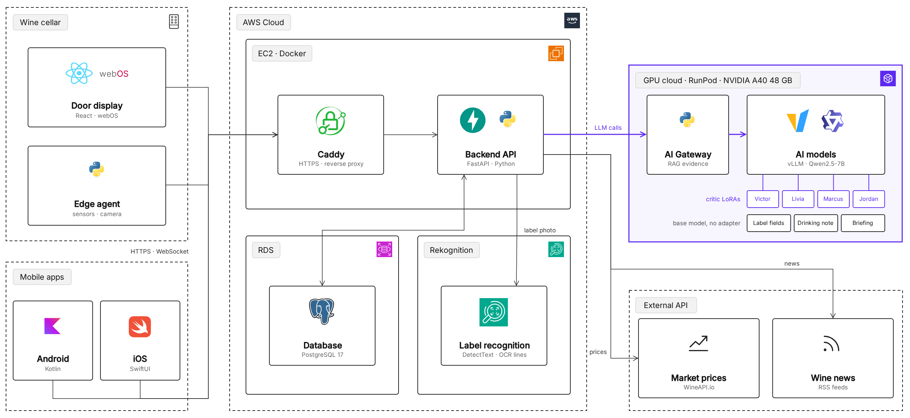

# OmniCave

**Wine cellar management with AI critics, designed for transparent display doors.**

> 26-2 Hanyang University Software Engineering Project


## Overview

Premium wine cellars today are passive appliances: they hold temperature and humidity, but the owner still tracks
every bottle by hand, in a notebook or a separate app that never matches what is physically inside. OmniCave turns
the cellar into an actively managed collection. The glass door becomes a transparent OLED display that shows exactly
what is stored and where, and the cellar keeps its own inventory up to date.

The system rests on three ideas:

- **The cellar knows its contents.** Each bottle's label is read once when it goes in, the system suggests a free
  spot, and every position is tracked in centimetres, including bottles stacked freely without fixed slots.
- **Expert opinion on every bottle.** Four fictional wine critics, each with its own scoring philosophy, debate a
  wine live on the door. They share one base language model with a separate LoRA adapter per critic, swapped on the server.
- **A thin appliance, a smart cloud.** All AI runs in the cloud, so the cellar's own computer stays small, cool and
  cheap, and every feature is shared with the companion apps.

## Links

| Resource | Link |
|---|---|
| Paper | [PDF](documents/wine_cellar.pdf) · [LaTeX source](documents/wine_cellar.tex) |
| Presentation slides | *coming soon* |
| Blog | *coming soon* |
| Demo video | *coming soon* |
| Live demo | [omnicave.vercel.app](https://omnicave.vercel.app) |

## Key Features

- **AI critic debate:** four fictional critics (Victor, Livia, Marcus and Jordan), each a LoRA adapter on one shared
  Qwen2.5-7B model served by vLLM, debate a bottle with evidence retrieved for that wine, streamed word by word. On
  unseen wines they stay in character in 98–100% of answers, against 0–28% for the base model.
- **Label recognition:** photograph a bottle; Amazon Rekognition reads the text, the same Qwen model turns it into
  wine fields (fixing OCR slips, never inventing a vintage), the backend matches it to a wine and suggests a free spot,
  and the owner confirms. Wines outside the catalog keep the fields the model read.
- **Drinking windows:** wines without a known window get one from an aging table built from 13,561 windows stated in
  published reviews (status match 87.5%, against 69% for a fixed rule), with a short note on when to open the bottle.
- **Bottles mapped in centimetres:** free stacking with gravity, a to-scale door view and a 3D view. Scan
  reconciliation turns successive scans into new, moved, removed and hidden bottles.
- **Climate monitoring:** temperature and humidity per zone, with history and alerts, from the paired appliance
  (simulated readings when no appliance is connected).
- **Daily briefing and collection value:** wine news ranked against the owner's bottles, with a short AI note that
  links today's stories to those bottles and cites each one, plus bottles ready to drink and market value over time.
  Prices come from WineAPI.io where available, otherwise a labelled estimate.
- **One account, every screen:** the door display, the Android app and the iOS app stay in sync live over WebSocket,
  across several cellars, with offline caching.
- **Privacy by design:** 19+ age check, PIPA consents, and data export and account deletion.

## Architecture



## Tech Stack

| Layer | Technologies |
|---|---|
| Door display | React 19, TypeScript, Vite, webOS; |
| Mobile | Kotlin, Jetpack Compose (Android); SwiftUI (iOS) |
| Backend | Python 3.12, FastAPI, WebSocket (live sync)|
| Database | PostgreSQL 17 on Amazon RDS; SQLite for development |
| AI critics | Qwen2.5-7B-Instruct with one LoRA adapter per critic, served by vLLM on RunPod, behind our RAG gateway |
| Vision and data | Amazon Rekognition (label text), WineAPI.io (market prices) |
| Infrastructure | Amazon EC2, Docker Compose, Caddy (HTTPS), GitHub Actions (CI) |

## Demo Video

<!-- TODO: replace with a YouTube thumbnail linking to the video:
<a href="https://www.youtube.com/watch?v=VIDEO_ID"></a>
-->
*Coming soon.*

## Repository

```
omnicave/
├── backend/                   # FastAPI cloud API shared by all clients
│   ├── app/                   #   routes, inventory, vision, AI critics, accounts
│   └── tests/                 #   pytest suite (SQLite and PostgreSQL in CI)
├── webos/
│   ├── wine-cellar-display/   # door display (React, webOS, Vercel)
│   └── edge/                  # appliance simulator: pairing, sensors, scans
├── mobile/
│   ├── Kotlin/                # Android app
│   └── ios/                   # iOS app
├── AI-7B/                     # critic LoRA training, evaluation and RAG gateway
├── deploy/                    # AWS deployment (Docker Compose, Caddy)
├── documents/                 # paper, requirements coverage, diagrams
└── .github/workflows/         # CI
```

## Team

| Name | Organization | Email |
|---|---|---|
| Naomi K. Fossaberg | Department of Computer Science, IT University of Copenhagen | nafo@itu.dk |
| Enkhbold Myagmarjav | Department of Information Systems, Hanyang University | enkheeboldu@hanyang.ac.kr |
| Chiang Jun Han | Department of Electrical and Electronic Engineering, Nanyang Technological University | jchiang009@e.ntu.edu.sg |
| Sungbin Bae | Department of Mathematics, Hanyang University | charliepro@hanyang.ac.kr |
